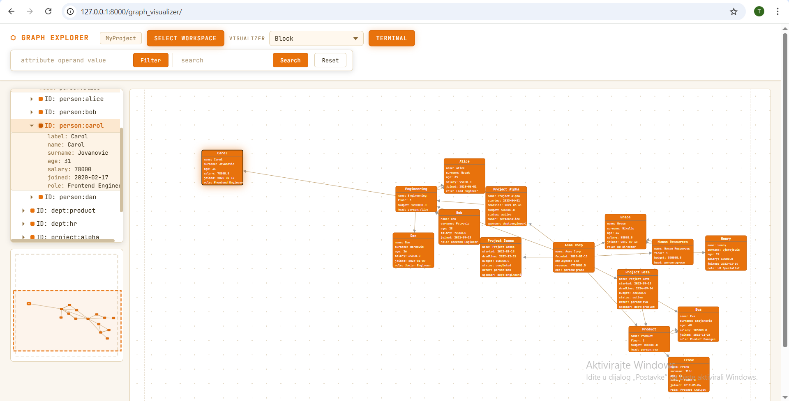
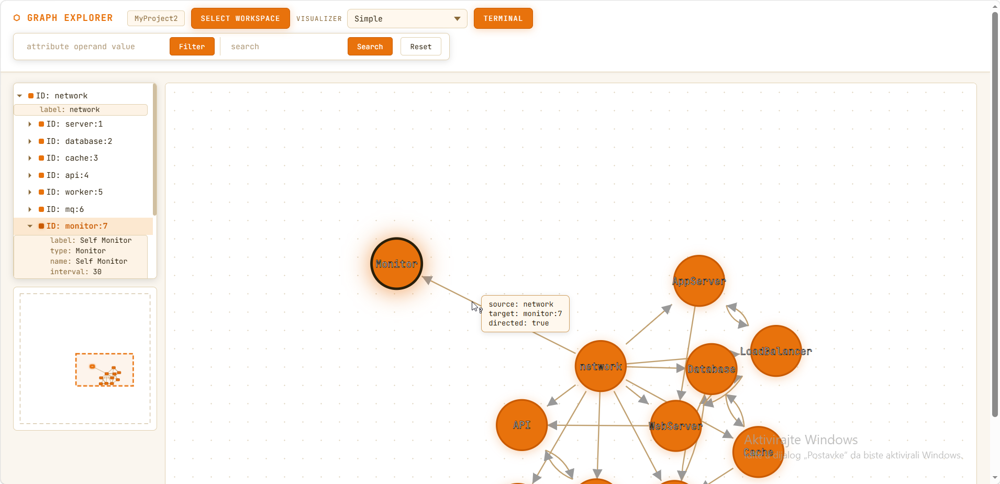
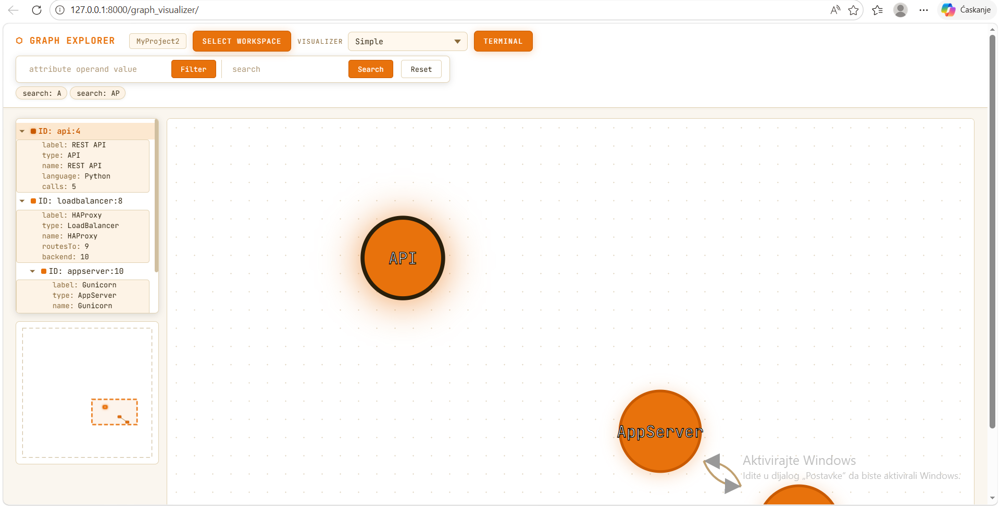
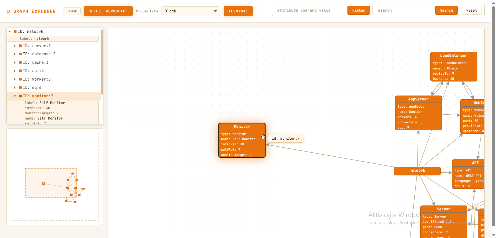

# Graph Explorer Platform

A modular, plugin-based platform for parsing, modeling, visualizing, searching, and manipulating graph structures. Built with a clean plugin architecture that allows data sources and visualizers to be swapped or extended independently — the platform remains framework-agnostic and integrates with both Django and Flask.

---

## Features

- **Multiple data source formats** — JSON, XML, and CSV plugins for loading arbitrary graph data
- **Two visualization modes** — Simple (force-directed layout) and Block (attribute-rich rectangles)
- **Three simultaneous views** — Main View (interactive canvas), Tree View (collapsible hierarchy), and Bird View (minimap with synchronized viewport)
- **Search & filtering** — text-based search and attribute-level filtering (`age > 30`) with support for chained operations; applied server-side on the graph model
- **Type-aware graph model** — supports directed, undirected, acyclic, and cyclic graphs; attributes typed as `int`, `float`, `str`, or `date`
- **CLI** — in-browser terminal for creating, editing, and deleting nodes/edges; filtering and searching via command syntax
- **Multi-workspace** — load multiple graphs simultaneously, each with its own active filters and search state
- **Dual framework support** — identical functionality available via both Django and Flask interfaces

---

## Screenshots

<table>
  <tr>
    <td></td>
    <td></td>
  </tr>
  <tr>
    <td></td>
    <td></td>
  </tr>
</table>

## Tech Stack

- **Language**: Python 3.11+
- **Web frameworks**: Django, Flask
- **Frontend**: HTML, CSS, JavaScript, D3.js
- **Plugin system**: installable Python packages via `pip install -e`
- **Templating**: Jinja2 (visualizer plugins generate HTML string representations)
- **Data formats**: JSON, XML, CSV

---

## Architecture

The platform follows a strict plugin-based architecture. All components communicate through a shared API library — neither the platform nor the plugins depend on each other directly.

```
graph-explorer-platform/
├── api/                  # Abstract interfaces and graph data model (shared dependency)
├── platform/             # GraphService, Workspace, CLI, PluginRegistry
├── json_plugin/          # Data source plugin — JSON
├── xml_plugin/           # Data source plugin — XML
├── csv_plugin/           # Data source plugin — CSV
├── simple_visualizer/    # Visualizer plugin — force-directed layout
├── block_visualizer/     # Visualizer plugin — attribute block layout
├── django/               # Django web application
└── flask/                # Flask web application
```

- `api` — defines abstract base classes for data source and visualizer plugins, as well as the graph model (`Node`, `Edge`, `Graph`). Used as a dependency by all other components.
- `platform` — implements `GraphService` (graph operations, search, filter), `PluginRegistry` (auto-discovers installed plugins), `Workspace` (per-session graph + filter state), and the CLI interpreter.
- Data source plugins — parse input files and construct typed graph instances using the `api` model.
- Visualizer plugins — receive a `Graph` object and return an HTML string (with embedded CSS/JS) for rendering.
- Web apps — Django and Flask applications that wire together the platform and plugins and expose them via a browser UI.

---

## Team

| Student | Index |
|---|---|
| Teodora Aleksic | SV7/2023 |
| Lenka Nikolic | SV16/2023 |
| Igor Maljik | SV37/2023 |
| Lazar Jovic | SV43/2023 |
| Vukasin Vujovic | SV11/2023 |

---

## Prerequisites

- Python 3.11+
- pip

---

## Running the Application

### Django

**Linux / macOS**
```bash
chmod +x run_django.sh
./run_django.sh
```

**Windows (PowerShell)**
```powershell
.\run_django.ps1
```

Open http://127.0.0.1:8000

---

### Flask

**Linux / macOS**
```bash
chmod +x run_flask.sh
./run_flask.sh
```

**Windows (PowerShell)**
```powershell
.\run_flask.ps1
```

Open http://127.0.0.1:5000

---

### Manual Setup

```bash
# 1. Create and activate virtual environment
python -m venv venv

# Windows
venv\Scripts\activate
# Linux / macOS
source venv/bin/activate

# 2. Install all components (order matters — api first)
pip install -e ./api
pip install -e ./platform
pip install -e ./json_plugin
pip install -e ./xml_plugin
pip install -e ./csv_plugin
pip install -e ./simple_visualizer
pip install -e ./block_visualizer

# 3a. Run Django
cd django
python manage.py migrate
python manage.py runserver

# 3b. Or run Flask
cd flask
python app.py
```

---

## Running Tests

**Linux / macOS**
```bash
chmod +x test.sh
./test.sh
```

**Windows (PowerShell)**
```powershell
.\test.ps1
```

The test scripts automatically set up the virtual environment, install all dependencies, and run the full test suite.

---

## Plugin System

New data source or visualizer plugins can be added without modifying the platform. A data source plugin only needs to implement the `DataSourcePlugin` interface from `api`, and a visualizer plugin implements `VisualizerPlugin`. Once installed into the active virtual environment, the platform's `PluginRegistry` detects them automatically.

---

## Design Patterns

Design patterns are applied throughout the codebase and were a deliberate part of the architecture. Their usage is discussed during the project defense.

---

## Class Diagram

The class diagram covering the graph model and plugin interfaces is available in the [`/diagrams`](./diagrams) folder.
